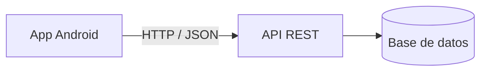
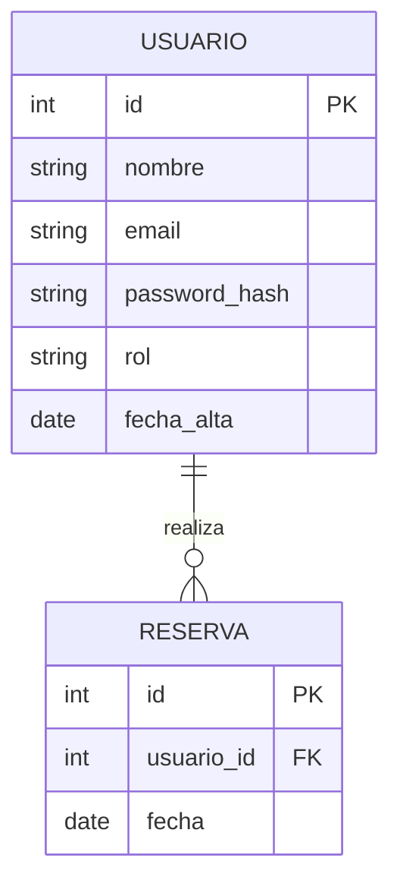
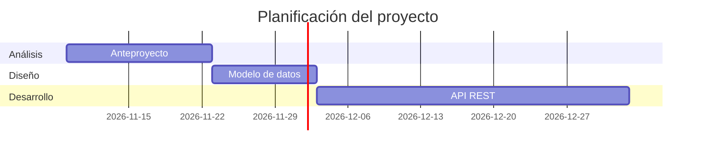

<!--
PLANTILLA DE MEMORIA · PROYECTO INTERMODULAR 2º DAM · IES JUAN BOSCO · 2026-2027

Cómo usar esta plantilla:
- Copia este fichero en la carpeta docs/ de tu repositorio.
- Los textos entre marcas de comentario HTML (como este bloque) son instrucciones: no se ven en GitHub ni en el PDF. Bórralos cuando completes cada apartado.
- Sustituye todo lo que aparece [entre corchetes].
- Puedes reordenar o renombrar apartados si tu proyecto lo necesita, pero el contenido debe estar.
- Las imágenes van en docs/img/ y se enlazan así: 
- Los diagramas pueden hacerse con Mermaid (hay ejemplos en esta plantilla). Comprueba que se ven bien al generar el PDF; si no, expórtalos como imagen.
-->

# [Nombre de la aplicación]

**Proyecto intermodular · 2º Desarrollo de Aplicaciones Multiplataforma**
**IES Juan Bosco · Curso 2026-2027**

**Autor/a:** [Nombre y apellidos]
**Repositorio:** [enlace al repositorio]

---

## Índice

1. [Introducción](#1-introducción)
2. [Análisis de requerimientos](#2-análisis-de-requerimientos)
3. [Diseño y planificación](#3-diseño-y-planificación)
4. [Implementación y pruebas](#4-implementación-y-pruebas)
5. [Documentación](#5-documentación)
6. [Mantenimiento y evolución](#6-mantenimiento-y-evolución)
7. [Conclusiones](#7-conclusiones)
8. [Declaración de uso de IA generativa](#8-declaración-de-uso-de-ia-generativa)
9. [Bibliografía y referencias](#9-bibliografía-y-referencias)

---

## 1. Introducción

### 1.1. Presentación del proyecto

<!-- ¿Qué es tu aplicación? Descríbela en pocas líneas, como si se la explicaras a alguien que no la conoce. -->
DualWallet es una aplicación la cual divide los gastos entre compañeros de piso o parejas por partes iguales. Calcula saldos y deudas pendientes automáticamente, se pueden añadir archivos (en la versión de escritorio) o añadir un gasto con dos clicks en la app para móviles 

### 1.2. Objetivos del proyecto

<!-- Objetivo general y objetivos específicos. Deben ser concretos y comprobables: al final (apartado 7.2) tendrás que decir si los has cumplido. -->

**Objetivo general:**

**Objetivos específicos:**

- 
- 

### 1.3. Justificación del proyecto

<!-- ¿Por qué este proyecto? ¿Qué problema resuelve o qué necesidad cubre? -->

---

## 2. Análisis de requerimientos

### 2.1. Identificación de necesidades y requerimientos

<!-- Requisitos funcionales (qué hace la aplicación) y no funcionales (rendimiento, seguridad, usabilidad, accesibilidad...). Una tabla con código, descripción y prioridad suele funcionar bien. -->

**Requisitos funcionales**

| Código | Descripción | Prioridad |
|---|---|---|
| RF01 | El usuario puede registrarse en la aplicación | Alta |
| RF02 | | |

**Requisitos no funcionales**

| Código | Descripción |
|---|---|
| RNF01 | Las contraseñas se almacenan cifradas mediante hash |
| RNF02 | |

### 2.2. Identificación del público

<!-- ¿Quién va a usar tu aplicación? Perfil, edad, conocimientos técnicos, necesidades especiales... -->

### 2.3. Estudio de mercado y competencia

<!-- Aplicaciones similares que ya existen. ¿Qué hacen bien, qué les falta, en qué se diferencia la tuya? -->

| Aplicación | Puntos fuertes | Puntos débiles | Diferencia con mi proyecto |
|---|---|---|---|
| | | | |

### 2.4. Protección de datos

<!-- Qué datos personales recoge la aplicación, para qué y cómo se protegen. Breve referencia al RGPD. Recuerda que los datos de prueba deben ser ficticios. -->

---

## 3. Diseño y planificación

### 3.1. Arquitectura del proyecto

<!-- Componentes del proyecto y cómo se comunican: base de datos, API, clientes, Odoo si procede. Indica tecnologías y versiones. -->

**Tecnologías utilizadas**

| Componente | Tecnología | Versión |
| --- | --- | --- |
| Base de datos | | |
| API REST | | |
| Cliente | | |

### 3.2. Modelo de datos

<!-- Diagrama entidad-relación y descripción de cada tabla. Recuerda: mínimo 4 tablas, todas con clave primaria, y al menos una columna de tipo fecha. -->

### 3.3. Diseño de la API

<!-- Endpoints de la API. Si usas Swagger/OpenAPI, puedes enlazarlo aquí además de la tabla. -->

| Método | Endpoint | Descripción | Requiere rol |
| --- | --- | --- | --- |
| POST | `/api/auth/login` | Inicio de sesión | — |
| GET | `/api/usuarios` | Lista de usuarios | Admin |

### 3.4. Diseño de la interfaz de usuario

<!-- Prototipo (bocetos, Figma, Penpot...), guía de estilo (colores, tipografías, logotipo) y decisiones de usabilidad y accesibilidad. Incluye capturas del prototipo. -->

### 3.5. Planificación de tareas y recursos

<!-- Cómo has organizado el trabajo: enlace al tablero de GitHub Projects, hitos, estimación de tiempos, recursos hardware y software necesarios. -->

---

## 4. Implementación y pruebas

### 4.1. Desarrollo de las funcionalidades

<!-- Explica cómo has implementado las partes más importantes: login, CRUD de usuarios, roles, funcionalidades propias... Puedes incluir fragmentos cortos de código, pero el código completo está en el repositorio. -->

### 4.2. Seguridad

<!-- Cómo has cifrado las contraseñas, cómo gestionas las credenciales (.env, .gitignore), cómo controlas el acceso por roles. -->

### 4.3. Pruebas unitarias y de integración

<!-- Plan de pruebas: qué has probado, cómo y con qué resultado. Incluye las pruebas de formularios y vistas. -->

| Código | Qué se prueba | Resultado esperado | Resultado obtenido |
| --- | --- | --- | --- |
| P01 | Login con contraseña incorrecta | Mensaje de error, no se accede | |

### 4.4. Corrección de errores y optimización

<!-- Errores importantes que encontraste, cómo los resolviste y mejoras de rendimiento aplicadas. -->

---

## 5. Documentación

### 5.1. Documentación técnica

<!-- Estructura del código, librerías y dependencias externas con su configuración, decisiones técnicas relevantes. -->

### 5.2. Manual de usuario

<!-- Cómo se usa la aplicación, paso a paso, con capturas. Incluye la parte de administración. -->

### 5.3. Manual de instalación y configuración

<!-- Requisitos previos y pasos para poner en marcha todo el proyecto desde cero: base de datos, API, cliente. Debe coincidir con lo que pone el README. -->

---

## 6. Mantenimiento y evolución

### 6.1. Posibles mejoras

<!-- Qué mejorarías o añadirías con más tiempo. -->

### 6.2. Actualizaciones futuras

<!-- Cómo evolucionaría el proyecto: nuevas plataformas, nuevas funcionalidades, escalabilidad... -->

---

## 7. Conclusiones

### 7.1. Evaluación del proyecto

### 7.2. Cumplimiento de objetivos y requisitos

<!-- Repasa los objetivos del apartado 1.2 y los requisitos del 2.1: ¿se han cumplido? Si alguno no, explica por qué. -->

| Objetivo / requisito | ¿Cumplido? | Observaciones |
| --- | --- | --- |
| | | |

### 7.3. Lecciones aprendidas y recomendaciones

---

## 8. Declaración de uso de IA generativa

<!-- Indica todas las herramientas de IA generativa que has utilizado (también para el logotipo, las imágenes o la redacción). Si no has utilizado ninguna, indícalo expresamente. -->

| Herramienta | Uso | Parte del proyecto | Revisión / adaptación realizada |
| --- | --- | --- | --- |
| [Ej.: Claude, ChatGPT, Copilot...] | [Ej.: generación del logotipo, depuración de un error, revisión ortográfica...] | [Ej.: API, apartado 2.3...] | [Ej.: adapté el código a mi modelo de datos y lo probé...] |

---

## 9. Bibliografía y referencias

<!-- Documentación oficial, tutoriales, libros, vídeos, repositorios... Indica título, autor o web, enlace y fecha de consulta. -->

-  
